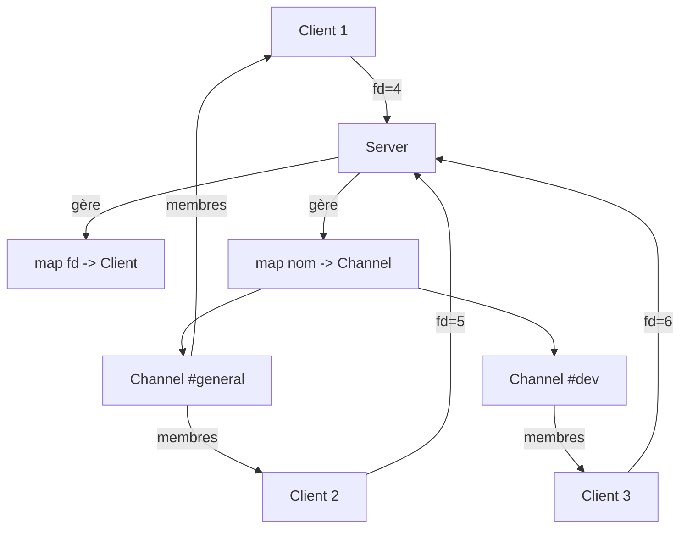
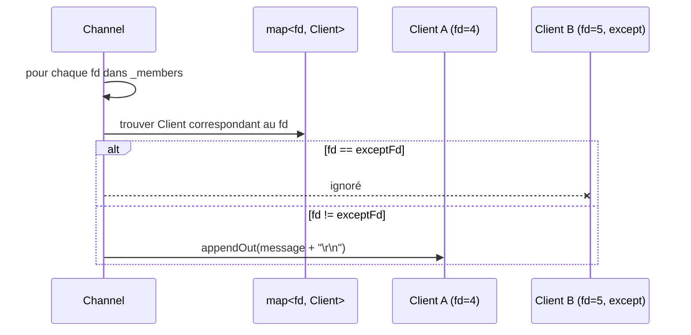
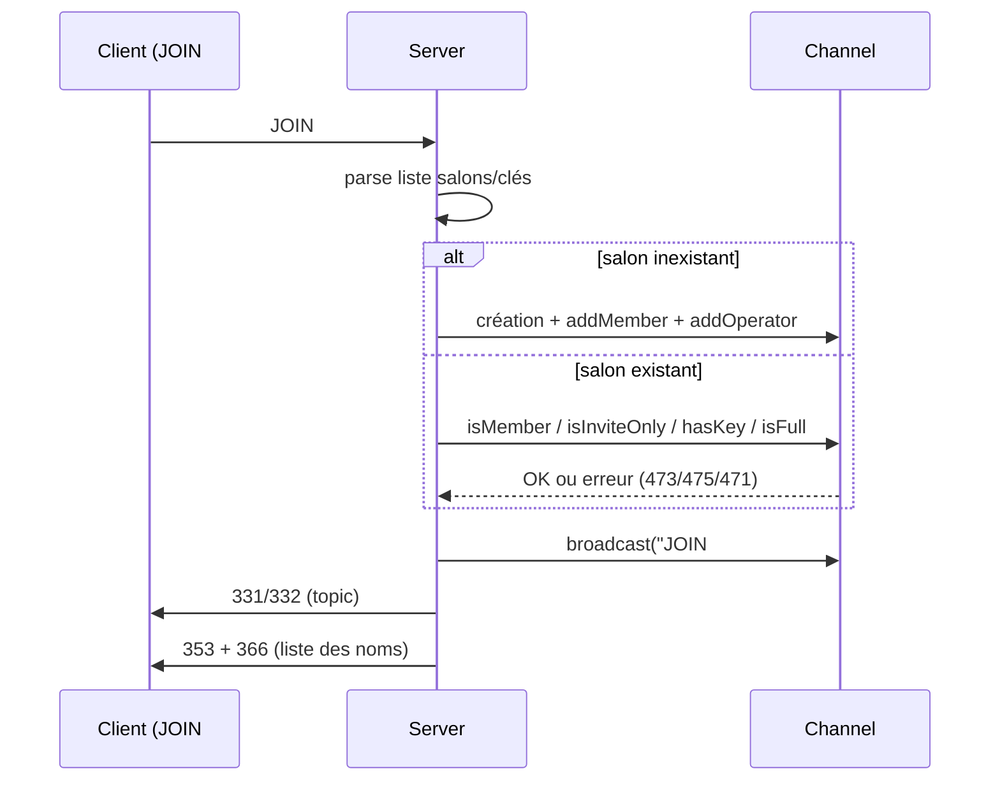
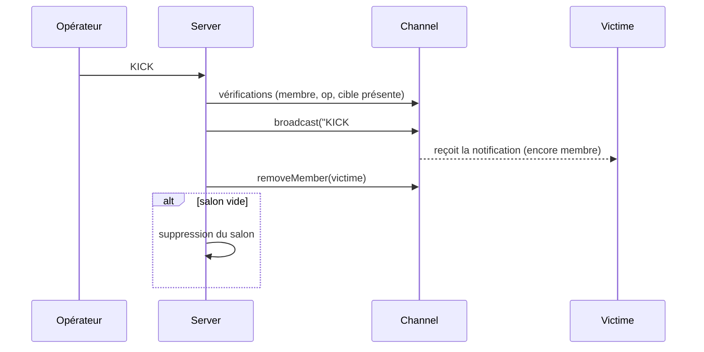
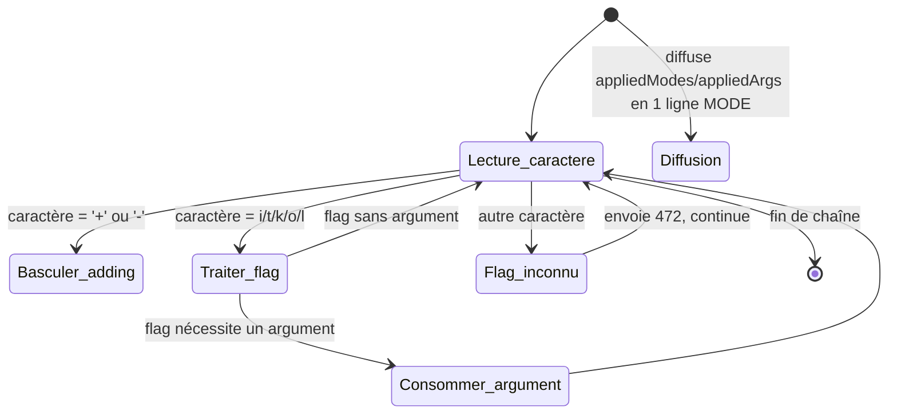
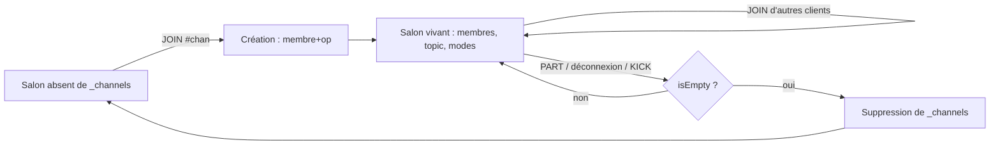

# ft_irc — Module Channels : Documentation approfondie
### Support de référence pour génération de présentation (slides + schémas)

> Ce document est une version enrichie et pédagogique de la documentation technique du module `Channel` de ft_irc.
> Il est structuré pour qu'un agent IA puisse en extraire directement un plan de slides, des schémas (diagrammes Mermaid inclus, prêts à être rendus en image) et des exemples concrets.
> Langue : français. Niveau : présentation de soutenance (école 42).

---

## 0. Plan de présentation suggéré

1. Contexte : qu'est-ce qu'un serveur IRC minimal (ft_irc) ?
2. Contraintes du projet (C++98, non-bloquant, pas de `send()` direct)
3. Architecture générale (Server / Client / Channel)
4. La classe `Channel` — état et invariants
5. Les helpers `Server` — la « boîte à outils » des handlers
6. Les 5 handlers de commandes (JOIN, INVITE, KICK, TOPIC, MODE) — un slide par commande avec diagramme de séquence
7. Le système de codes numériques IRC (RFC 1459 / 2812)
8. Le cycle de vie d'un salon (création → vie → suppression)
9. Points de soutenance / questions pièges
10. Conclusion / démo

---

## 1. Contexte général

IRC (Internet Relay Chat) est un protocole texte, orienté message, où le serveur relaie des commandes entre clients. `ft_irc` réimplémente un sous-ensemble de ce protocole : connexion, authentification, salons (channels), et un jeu de commandes (`JOIN`, `PART`, `PRIVMSG`, `KICK`, `INVITE`, `TOPIC`, `MODE`...).

Un **salon** (`Channel`) est une structure partagée : plusieurs clients (identifiés par leur **file descriptor**, `fd`) s'y retrouvent, en discutent, et certains ont des droits d'administration (**opérateurs**).

### Schéma — vue d'ensemble (à rendre en diagramme)



**Idée clé à faire ressortir en slide** : le `Server` est le chef d'orchestre. Il possède *toutes* les connexions (`_clients`) et *tous* les salons (`_channels`). Le `Channel`, lui, ne connaît **que des entiers (fd)** — jamais de pointeur vers un `Client`. C'est un choix de conception majeur (voir section 8).

---

## 2. Contraintes techniques du projet (à mentionner en slide "contraintes")

| Contrainte | Pourquoi | Conséquence dans le code |
|---|---|---|
| C++98 strict | Norme imposée par le sujet 42 | Pas de `auto`, pas de `std::to_string` → `std::stringstream`, pas de `std::stoi` → `std::atoi` |
| Pas de `send()` direct dans la logique métier | Le réseau est non bloquant (`poll`/`select`) | Toute sortie passe par `client.appendOut(...)`, un buffer vidé plus tard par la boucle d'I/O |
| Tout finit par `\r\n` | RFC IRC : fin de ligne obligatoire | Chaque message construit se termine par `"\r\n"` avant `appendOut` |
| Membres/opérateurs/invités = `std::vector<int>` | Simplicité, petit nombre d'éléments par salon | Recherche linéaire (`isMember`, `isOperator`...) — acceptable en complexité ici |

---

## 3. La classe `Channel` — détail complet

### 3.1 Forme canonique de Coplien

```cpp
Channel();                          // OBLIGATOIRE
Channel(const std::string &name);
Channel(const Channel &other);
Channel &operator=(const Channel &other);
~Channel();
```

**Pourquoi le constructeur par défaut est indispensable** (question de soutenance classique) :
`std::map<std::string, Channel>::operator[]` fonctionne ainsi :
1. Si la clé n'existe pas → **construit une valeur par défaut** et l'insère.
2. Retourne une référence à cette valeur.

Donc `_channels["#general"] = Channel("#general");` appelle *d'abord* `Channel()` (implicitement, pour créer l'entrée dans la map), *puis* `operator=`. Sans constructeur par défaut accessible, **le code ne compile pas**.

### 3.2 État interne (à représenter en slide sous forme de tableau ou de "carte d'identité" du salon)

| Attribut | Type | Rôle |
|---|---|---|
| `_name` | `std::string` | Nom du salon (`#chan` ou `&chan`) |
| `_topic` | `std::string` | Sujet courant |
| `_key` | `std::string` | Mot de passe du salon (mode `+k`) |
| `_hasKey` | `bool` | Distingue "pas de clé" d'une "clé vide" — **détail important** |
| `_inviteOnly` | `bool` | Flag `+i` |
| `_topicLocked` | `bool` | Flag `+t` |
| `_limit` | `int` | Nombre max de membres (`+l`), `0` = illimité |
| `_members` | `std::vector<int>` | FDs des clients présents |
| `_operators` | `std::vector<int>` | FDs ayant les privilèges op |
| `_invited` | `std::vector<int>` | FDs autorisés à rejoindre malgré `+i` |

### 3.3 Accesseurs et prédicats

- `getName / getTopic / getKey / getMembers / getLimit` : accesseurs constants retournant des **références const**, pour éviter des copies inutiles de `std::vector`/`std::string`.
- `isInviteOnly / isTopicLocked / hasKey` : simples lectures de flags.
- `isMember(fd) / isOperator(fd) / isInvited(fd)` : recherche linéaire (`std::find`) dans le vecteur correspondant. **Ce sont les briques de base de tout contrôle d'accès** dans les 5 handlers — presque chaque commande commence par un appel à `isMember`.
- `isFull()` : `return _limit > 0 && _members.size() >= _limit;` → un `_limit` de `0` signifie "pas de limite", d'où le test `_limit > 0`.
- `isEmpty()` : `return _members.empty();` → signal utilisé par le `Server` pour savoir quand détruire un salon.

### 3.4 Mutateurs

`setTopic / setKey / unsetKey / setInviteOnly / setTopicLocked / setLimit` sont appelés uniquement par les handlers `TOPIC` et `MODE`. `setLimit(0)` correspond au retrait du mode `+l` côté modèle de données.

### 3.5 Gestion des collections

- `addMember / addOperator / addInvite` : vérifient l'absence avant `push_back` (pas de doublon).
- `removeMember(fd)` : **retire le fd de `_members` ET appelle en interne le retrait dans `_operators` et `_invited`**. Un seul point d'entrée = garantie qu'aucun FD "fantôme" ne reste opérateur ou invité après son départ.
- `removeOperator / removeInvite` : retraits ciblés (utilisés respectivement par `MODE -o` et lors de la consommation d'une invitation au moment du `JOIN`).

### 3.6 `getModeString()`

Construit dynamiquement une chaîne du type `+itkl clepublique 10` en parcourant les flags actifs, pour répondre à `MODE #chan` (sans argument) via `324 RPL_CHANNELMODEIS`.

### 3.7 `broadcast(message, exceptFd, clientsMap)`



Points clés à expliquer en slide :
- Le `Channel` ne stocke **aucun pointeur `Client*`**, seulement des `fd` (int). Il doit donc recevoir la map des clients en paramètre pour résoudre chaque `fd` en objet `Client` au moment de diffuser.
- Le paramètre `except` (`-1` = personne) permet d'exclure un émetteur (utile par ex. pour ne pas se ré-envoyer son propre message, sauf pour `JOIN` où tout le monde reçoit, y compris le nouvel arrivant).
- L'écriture réseau reste non bloquante : `broadcast` ne fait qu'empiler dans le buffer de sortie (`appendOut`), l'envoi effectif est géré ailleurs par la boucle `poll`.

---

## 4. Les helpers `Server` — la boîte à outils commune aux handlers

| Fonction | Rôle détaillé |
|---|---|
| `userPrefix(fd)` | Construit `:nick!user@localhost`, préfixe RFC obligatoire sur tout message *relayé* à d'autres clients (JOIN, KICK, TOPIC, MODE, INVITE). C'est ce préfixe qui permet au client IRC de savoir "qui a fait quoi". |
| `sendNumeric(fd, code, args)` | Construit `:serveur <code> <nick> <args>\r\n` — centralise le format des réponses numériques pour ne pas dupliquer la logique de formatage dans chaque handler. |
| `getFdByNick(nick)` | Parcourt `_clients` pour retrouver le `fd` associé à un pseudo. Retourne `-1` si absent. Base de `401 ERR_NOSUCHNICK` et `441 ERR_USERNOTINCHANNEL`. |
| `buildNamesList(channel)` | Construit la liste des pseudos du salon pour `353 RPL_NAMREPLY`, en préfixant `@` devant les opérateurs. |
| `removeFromChannel(fd, name)` | Retire un client d'un salon **et supprime le salon de `_channels` s'il devient vide**. Appelé à la fois par `PART` et par la routine de déconnexion — point de nettoyage mémoire critique. |
| `splitList(str, sep)` *(static)* | Découpe une chaîne via `std::stringstream` + `std::getline`, utilisé pour parser `JOIN #a,#b clé1,clé2` (listes séparées par virgules). |

---

## 5. Les 5 handlers de commandes

Pour chaque commande : présenter en slide (1) les contrôles d'erreur dans l'ordre, (2) l'effet si succès, (3) un diagramme de séquence.

### 5.1 `handleJoinCommand`

**Logique** :
1. Vérifie qu'il y a au moins un paramètre → sinon `461`.
2. Découpe listes de salons/clés séparées par virgules (appariement par index, via `splitList`).
3. Vérifie le préfixe du nom (`#` ou `&`) → sinon `476`.
4. **Salon inexistant** → création, l'auteur devient membre **et opérateur** (règle IRC universelle : le créateur d'un salon en est le premier opérateur).
5. **Salon existant** → contrôles dans cet ordre strict :
   - déjà membre → ignoré silencieusement
   - `+i` sans invitation → `473`
   - `+k` avec mauvaise clé → `475`
   - `+l` plein → `471`
6. Ajout du membre, consommation de l'invitation si présente.
7. Diffusion de `JOIN` à **tous** les membres (`except = -1`, le nouvel arrivant inclus), puis envoi **au seul arrivant** du topic (`331`/`332`) et de la liste des noms (`353`/`366`).



### 5.2 `handleInvitCommand`

Ordre des contrôles (tableau à représenter tel quel dans un slide "checklist") :

| Étape | Erreur si échec |
|---|---|
| Paramètres présents | `461` |
| Salon existant | `403` |
| Émetteur membre | `442` |
| Émetteur opérateur | `482` |
| Cible connectée | `401` |
| Cible pas déjà présente | `443` |

Effet si succès : le fd de la cible est ajouté à `_invited` (autorise le futur `JOIN` malgré `+i`), confirmation `341` à l'émetteur, message `INVITE` privé envoyé à la cible uniquement (pas de broadcast à tout le salon).

### 5.3 `handleKickCommand`

Contrôles : `461` → `403` → membre `442` → opérateur `482` → cible présente `441`.

**Point pédagogique fort** : le message `KICK` est diffusé **avant** l'appel à `removeMember`. Sinon la victime, déjà retirée de `_members`, ne recevrait jamais la notification de son propre kick. Après diffusion et retrait, si le salon devient vide, il est supprimé de `_channels`.



### 5.4 `handleTopicCommand`

Contrôles communs : `461` → `403` → membre `442`.

- **Lecture** (pas de second paramètre) : `331` si vide, `332` sinon.
- **Écriture** (second paramètre fourni) : si `+t` actif et émetteur non-opérateur → `482`. Sinon, `setTopic` + diffusion à tout le salon (pour que tous les clients connectés se synchronisent immédiatement).

### 5.5 `handleModeCommand`

Contrôles communs : `461` → `403`.

- **Consultation** (pas de chaîne de modes) : `324` avec `getModeString()`.
- **Modification** : membre `442` **et** opérateur `482` obligatoires.

**Algorithme de parsing** (bon candidat pour un schéma "machine à états") :
- Parcours caractère par caractère de la chaîne de modes.
- `+` / `-` bascule un booléen `adding`.
- Un compteur `argIndex` n'avance que pour les modes consommant un argument (`+k`, `+l`, `o` dans les deux sens) — ce qui permet de traiter correctement `MODE #chan +okl bob clepublique 10`.

| Flag | Argument ? | Effet |
|---|---|---|
| `i` | non | Active/désactive invite-only |
| `t` | non | Verrouille/déverrouille le topic aux opérateurs |
| `k` | oui | `+k` définit la clé, `-k` la supprime |
| `o` | oui | Donne/retire le statut opérateur ; `441` si cible absente |
| `l` | oui (en `+`) | `+l` fixe la limite via `std::atoi` (valeur ≤ 0 ignorée) ; `-l` remet à 0 |

Un mode inconnu → `472`, **sans interrompre** le traitement des modes suivants. Les modes réellement appliqués sont accumulés dans `appliedModes`/`appliedArgs`, puis diffusés en **une seule ligne `MODE`** — afin qu'un client ne voie jamais un changement qui a en réalité échoué.



---

## 6. Table des codes numériques (référence RFC 1459/2812)

| Code | Nom | Déclenché par |
|---|---|---|
| 324 | RPL_CHANNELMODEIS | MODE en lecture |
| 331 | RPL_NOTOPIC | JOIN / TOPIC, sujet vide |
| 332 | RPL_TOPIC | JOIN / TOPIC, sujet défini |
| 341 | RPL_INVITING | INVITE réussi |
| 353 | RPL_NAMREPLY | Liste des membres après JOIN |
| 366 | RPL_ENDOFNAMES | Fin de la liste des noms |
| 401 | ERR_NOSUCHNICK | INVITE vers un pseudo inconnu |
| 403 | ERR_NOSUCHCHANNEL | Salon inexistant |
| 441 | ERR_USERNOTINCHANNEL | KICK / MODE +o d'un non-membre |
| 442 | ERR_NOTONCHANNEL | Émetteur absent du salon |
| 443 | ERR_USERONCHANNEL | INVITE d'un membre déjà présent |
| 461 | ERR_NEEDMOREPARAMS | Arguments manquants |
| 471 | ERR_CHANNELISFULL | JOIN bloqué par +l |
| 472 | ERR_UNKNOWNMODE | Flag de mode inconnu |
| 473 | ERR_INVITEONLYCHAN | JOIN bloqué par +i |
| 475 | ERR_BADCHANNELKEY | JOIN bloqué par +k |
| 476 | ERR_BADCHANMASK | Nom de salon invalide |
| 482 | ERR_CHANOPRIVSNEEDED | Privilèges opérateur requis |

**Idée de slide** : regrouper visuellement par catégorie — succès/info (33x, 34x, 35x/36x), erreurs "je ne peux pas identifier ta cible" (40x), erreurs "tu n'as pas le droit / mauvais état" (44x, 47x, 48x), erreur "paramètres" (461).

---

## 7. Cycle de vie d'un salon (schéma récapitulatif)



**Trois points d'entrée identiques** suppriment un salon vide : `handleKickCommand`, `removeFromChannel` (via `PART`), et la routine de déconnexion. C'est un bon exemple à souligner de **duplication volontaire mais cohérente** d'une même règle de nettoyage, appliquée à chaque endroit où un membre peut quitter le salon.

---

## 8. Points de soutenance (questions/réponses à préparer)

| Question probable | Réponse synthétique |
|---|---|
| Pourquoi un constructeur par défaut sur `Channel` ? | `std::map::operator[]` construit une valeur vide avant affectation ; sans lui, le code ne compile pas. |
| Pourquoi `broadcast` prend la map des clients en paramètre ? | `Channel` ne stocke que des `fd` (int), jamais de pointeur `Client*` → zéro risque de pointeur pendant (dangling) après déconnexion d'un client. |
| Pourquoi diffuser le KICK avant le retrait du membre ? | La victime doit recevoir la notification ; après `removeMember`, elle n'est déjà plus dans `_members` et ne recevrait rien via `broadcast`. |
| Où le nettoyage mémoire des salons vides a-t-il lieu ? | Trois points : `handleKickCommand`, `removeFromChannel` (PART), routine de déconnexion. |
| Pourquoi `removeMember` purge aussi opérateur et invitation ? | Un `fd` fermé peut être **réattribué** par l'OS à une nouvelle connexion ; un résidu ferait passer, par erreur, ce nouveau client pour un ancien opérateur ou un invité. |
| Pourquoi `_hasKey` en plus de `_key` ? | Pour distinguer "aucune clé définie" d'une "clé vide" (chaîne vide) — deux états sémantiquement différents. |
| Pourquoi utiliser `std::vector<int>` et pas `std::set<int>` ? | Nombre de membres par salon généralement petit → recherche linéaire acceptable ; simplicité d'implémentation privilégiée dans le cadre du projet. |

---

## 9. Notes pour l'agent générant la présentation

- Utiliser un slide par grande section (0 à 8 ci-dessus), avec un slide supplémentaire par handler (5 slides pour JOIN/INVITE/KICK/TOPIC/MODE).
- Convertir chaque bloc ```mermaid``` en un schéma visuel réel (diagramme de séquence, graphe, ou diagramme d'état selon le type indiqué).
- Conserver les tableaux tels quels (ils fonctionnent bien en slides "checklist" ou "comparatif").
- Le ton doit rester technique mais pédagogique : chaque slide de handler doit répondre à "que vérifie-t-on ?", "que se passe-t-il si tout est OK ?", "qui reçoit quel message ?".
- Prévoir un slide de conclusion reprenant le schéma du cycle de vie d'un salon (section 7) comme fil rouge de toute la présentation.
